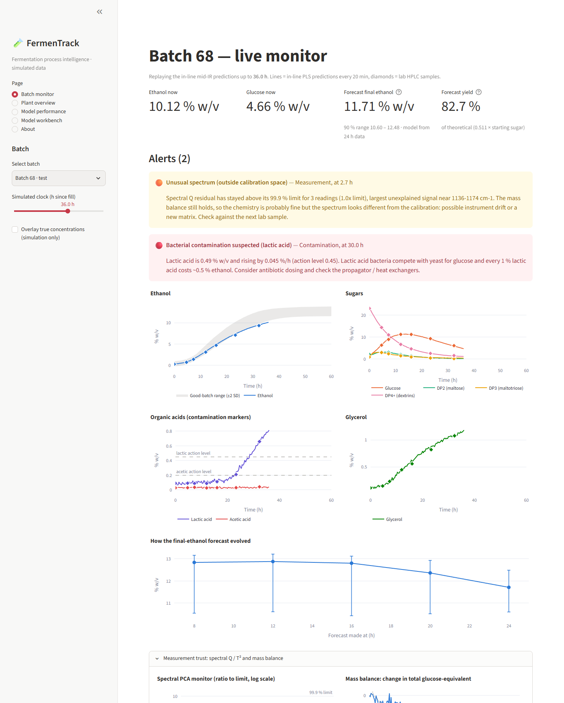
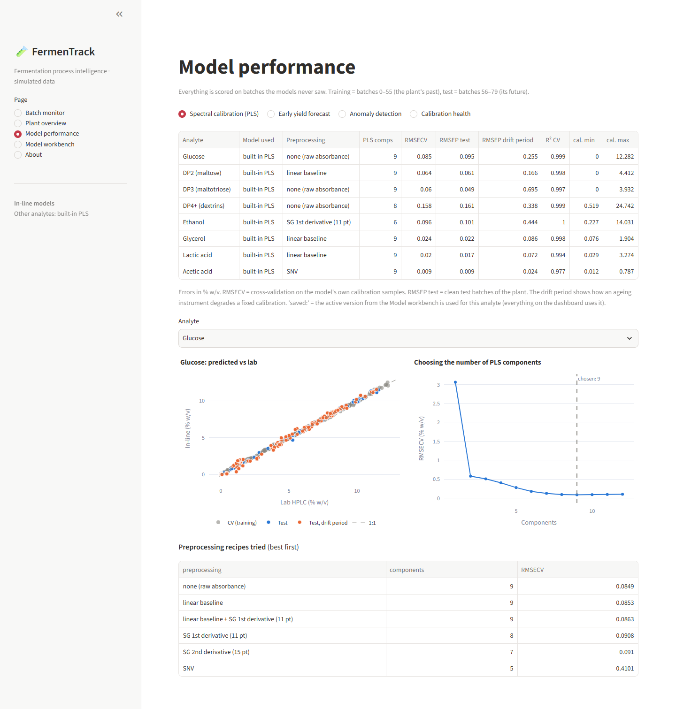
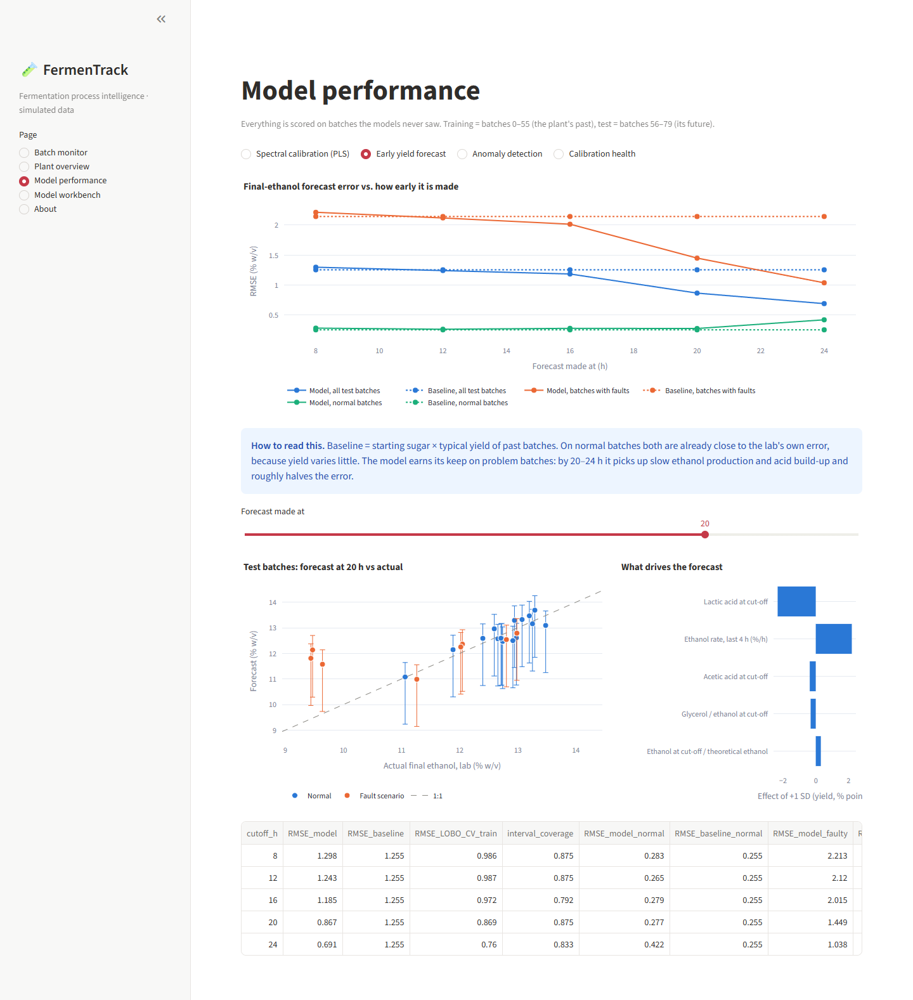
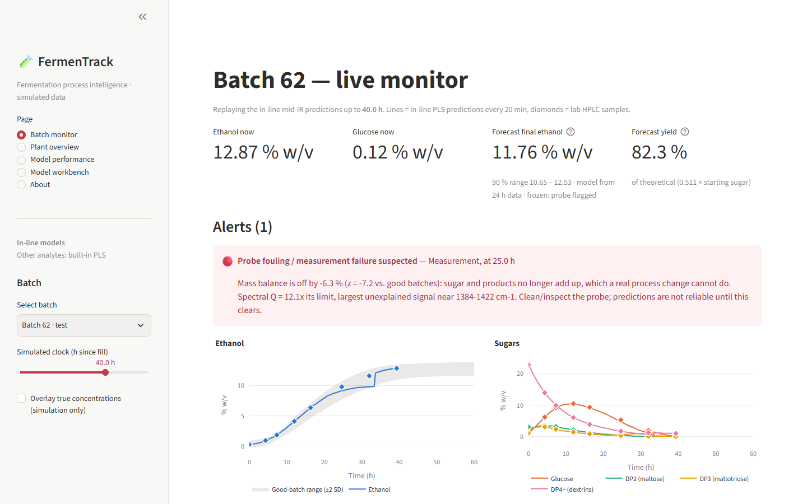
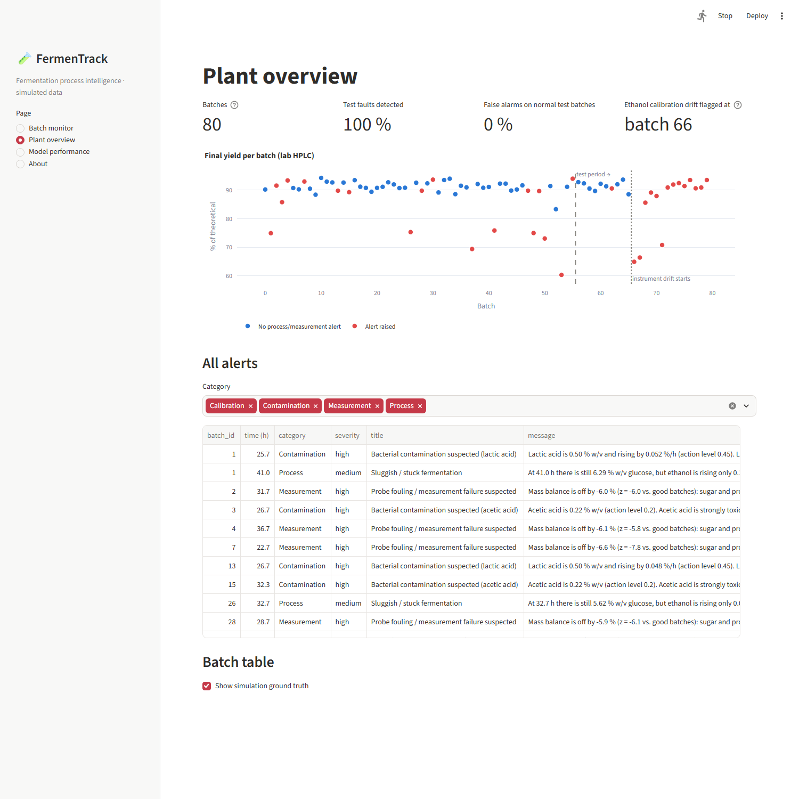

# FermenTrack

**Fermentation process intelligence from in-line mid-IR spectra: a local Python prototype.**

FermenTrack shows the full workflow a process-analytics team needs in a fuel-ethanol plant:
in-line spectra → concentrations (chemometrics) → early yield forecast, anomaly alerts with
reasons, and calibration-health monitoring → a dashboard operators can read.
It also includes a **Model Workbench** for building, validating, updating and automatically
checking your own PLS / ANN models from FTIR or NIR spectra and lab measurements.

**Start here:** [User guide](docs/USER_GUIDE.md) (how to open everything, which files to load,
step by step) · [Changelog](CHANGELOG.md) (what was added when)

> This is an independent portfolio project. **All data are simulated** (fixed seed, fully
> reproducible); no plant or vendor data or code are used. It runs entirely on a local
> machine, with no cloud services.



---

## Quick start (Windows)

1. Install Python 3.10+ (developed with 3.12).
2. Double-click **`FermenTrack.bat`**. It installs missing packages, starts the dashboard and
   opens it in your browser. On the first start it simulates the plant and trains every
   model (~15 s).

For the Model Workbench (build your own models from FTIR + lab data), double-click
**`Workbench.bat`** (see section 4).

Or from a terminal:

```bash
pip install -r requirements.txt
python -m fermentrack.pipeline      # simulate + train + evaluate, prints a report
streamlit run app.py                # dashboard at http://localhost:8501
pytest                              # 48 tests, ~40 s
```

Useful dashboard links: `?page=monitor&batch=68&t=30` (replay batch 68 up to 30 h),
`?page=performance&section=yield`, `?page=overview`.

---

## What is in the box

```
fermentrack/workbench/   Model Workbench: build / update / check your own spectral models
  io.py                  read spectra + reference values (Excel/CSV, rows or columns = samples)
  preprocess.py          regions, baseline, SNV/MSC, Savitzky-Golay smoothing/derivatives
  split.py               calibration/validation splits (random, Kennard-Stone, by group, by date...)
  models.py              PLS and PLS-ANN with cross-validation and figures of merit
  diagnostics.py         outliers: Hotelling T², Q residuals, leverage, studentised residuals
  robustness.py          perturbation, resampling and y-randomisation tests
  registry.py            versioned model storage, model cards, bias / augment updates
  autovalidate.py        self-check against new lab data (also a command-line tool)
  ui.py                  the workbench interface
workbench_app.py         stand-alone workbench (also a page inside app.py)
Workbench.bat            one-click launcher for the workbench
examples/                example FTIR files (simulated) with planted problems to find
fermentrack/
  config.py              all settings in one place (analytes, time grid, batch plan, thresholds)
  kinetics.py            fermentation model (enzymes + yeast + bacteria), one batch at a time
  spectroscopy.py        mid-IR spectrum simulator (Beer-Lambert + real-world artefacts)
  dataset.py             builds the 80-batch plant history + HPLC lab samples
  chemometrics.py        preprocessing (baseline, SNV, Savitzky-Golay) + NIPALS PLS1 + batch-wise CV
  yield_model.py         early final-ethanol forecast (physics ceiling x ML efficiency)
  anomaly.py             PCA T²/Q, mass balance, contamination & stuck rules -> alerts with reasons
  calibration_health.py  EWMA chart of (in-line - lab), rolling bias update
  pipeline.py            runs everything end to end, saves results to outputs/
app.py                   Streamlit dashboard
tests/                   pytest suite (physics sanity, chemometrics, rules, end-to-end)
FermenTrack.bat          one-click launcher
```

---

## 1. Simulated plant

**Why simulate?** Real plant data are confidential. A simulator also gives *ground truth*: we
know exactly when a contamination started, so every detection method can be scored honestly.

* **80 batches × 60 h**, one reading every 20 min (181 per batch), in chronological order.
  Batches 0–55 are the plant's past (training); 56–79 are its future (test).
* **Kinetics** (`kinetics.py`): corn-mash simultaneous saccharification and fermentation.
  Enzymes break DP4+ → DP3 → DP2 → glucose. Yeast activity grows logistically, takes up
  glucose (Monod kinetics) and slows down as ethanol and acids build up. Each batch draws its
  own starting sugar, enzyme rates, yeast vigour and glycerol share.
  Everything is tracked in glucose equivalents, so sugar that disappears shows up as
  products (a closed **mass balance**).
* **Faults**: lactic-acid bacteria, acetic-acid bacteria, stuck fermentation (yeast stress),
  probe fouling, and slow **instrument drift** from batch 66 (wavenumber shift + gain).
* **Spectra** (`spectroscopy.py`): 950–1500 cm⁻¹, built from Gaussian pure-component bands
  (e.g. ethanol ~1045/1087, glucose ~1035–1150, lactic ~1125, acetic ~1280, glycerol
  ~1040/1110 cm⁻¹). Added on top: noise, a wandering baseline, a batch-specific unknown
  matrix, a fouling film (dims the signal and adds broad bands) and the drift.
* **Lab samples**: 10 HPLC samples per batch, with realistic lab error.

## 2. Chemometrics: spectra → concentrations

For each of the 8 analytes (`chemometrics.py`):

1. Try six preprocessing recipes: raw, linear baseline, SNV, 1st/2nd Savitzky-Golay
   derivatives, and baseline + derivative.
2. For each, fit **PLS1 (NumPy NIPALS)** with 1–12 latent variables and score it with
   **batch-wise cross-validation**. All samples of a batch are left out together, because
   samples from the same batch share a matrix and would otherwise make the error look too good.
3. Keep the recipe with the lowest RMSECV, then the **smallest** number of components within 5 %
   of the best (protection against overfitting).
4. Report RMSEP on test batches, separately for the clean period and the drift period.

| Analyte | Preprocessing chosen by CV | LVs | RMSECV | RMSEP test | RMSEP drift period |
|---|---|---|---|---|---|
| Glucose | none (raw absorbance) | 9 | 0.085 | 0.095 | 0.255 |
| DP2 | linear baseline | 9 | 0.064 | 0.061 | 0.166 |
| DP3 | none (raw absorbance) | 9 | 0.060 | 0.049 | 0.695 |
| DP4+ | none (raw absorbance) | 8 | 0.158 | 0.161 | 0.338 |
| Ethanol | SG 1st derivative | 6 | 0.096 | 0.101 | 0.444 |
| Glycerol | linear baseline | 9 | 0.024 | 0.022 | 0.086 |
| Lactic acid | linear baseline | 9 | 0.020 | 0.017 | 0.072 |
| Acetic acid | SNV | 9 | 0.009 | 0.009 | 0.024 |

All errors in % w/v. Test errors match cross-validation errors, so the CV is honest. The last
column shows why calibration maintenance matters: a fixed model degrades 2–10× as the
instrument ages.



## 3. Process intelligence

### 3a. Early final-ethanol forecast (`yield_model.py`)

A **hybrid model** (physics + ML):

* Chemistry sets the ceiling: *theoretical ethanol = 0.511 × starting sugar*.
* Machine learning predicts only the **efficiency** (share of that ceiling the batch will reach)
  from 5 interpretable early signs: progress so far, ethanol rate over the last 4 h,
  glycerol/ethanol ratio (glycerol is a classic yield-loss driver), lactic and acetic acid.
* Forecast = efficiency × theoretical. One model per cut-off time (8, 12, 16, 20, 24 h).

Choices made for honesty:

* Features only use data up to the cut-off (a test checks this).
* Chronological train/test split by batch.
* **Huber (robust) regression**: some training batches were hit later by faults no early
  signal could foresee. Robust loss stops them from distorting the typical behaviour.
* **Asymmetric 90 % interval** from leave-one-batch-out errors: a batch can turn out much
  worse than expected, but rarely much better.
* Always compared with a naive baseline (starting sugar × typical yield).

| Forecast at | RMSE, all test | Baseline | RMSE, faulty batches | Baseline | RMSE, normal batches | Baseline |
|---|---|---|---|---|---|---|
| 8 h | 1.30 | 1.25 | 2.21 | 2.14 | 0.28 | 0.25 |
| 16 h | 1.19 | 1.25 | 2.01 | 2.14 | 0.28 | 0.25 |
| 20 h | **0.87** | 1.25 | **1.45** | 2.14 | 0.28 | 0.25 |
| 24 h | **0.69** | 1.25 | **1.04** | 2.14 | 0.42 | 0.25 |

**Interpretation.** On normal batches, yield varies so little that the baseline is already
close to the lab's own error, and the model matches it. The model adds value on problem
batches: by 20–24 h it sees slow ethanol production and acid build-up and roughly halves the
error. Before ~16 h, faults that have not started yet cannot be foreseen. At 24 h the normal-batch
error grows because the drifting instrument biases the inputs, which is another reason to watch
calibration health. In the dashboard the forecast is **frozen** when the probe is flagged,
so bad data are never used.



### 3b. Anomaly detection with reasons (`anomaly.py`)

Two questions, in the order an engineer would ask them:

1. **Can I trust the measurement?**
   * *Spectral PCA monitor*: built on the calibration spectra (9 components, kept while their
     variance is clearly above noise). **Q (SPE)** = what the model cannot explain, e.g. a new
     substance, fouling or drift. **Hotelling T²** = unusual but known variation. 99.9 % limits
     (F distribution for T², Box's χ² approximation for Q).
   * *Mass balance*: sugars + products (as glucose equivalents) must stay constant. **Real
     process faults keep the balance; a dirty probe breaks it.** This is what separates
     "the batch is sick" from "the sensor is sick".
2. **Is the chemistry going wrong?** (only checked while the mass balance holds)
   * *Contamination*: lactic acid above 0.45 % w/v and still rising, or acetic acid above 0.20 % w/v.
   * *Stuck fermentation*: glucose still available, ethanol behind the **golden-batch envelope**
     (mean ± SD of good past batches at the same hour), and ethanol rising < 0.15 %/h.

Every condition must persist for several readings (removes one-off spikes). All checks are
**causal**: an alarm at time *t* uses only data up to *t*, as it would run live. Every alert
carries a plain-language reason and a suggested action.

| Fault (test batches) | Batches | Detected | Median delay* |
|---|---|---|---|
| Lactic-acid bacteria | 3 | 3/3 | 18 h |
| Acetic-acid bacteria | 1 | 1/1 | 20 h |
| Stuck fermentation | 2 | 2/2 | 16 h |
| Probe fouling | 2 | 2/2 | 5 h |
| **False alarms on normal batches** | 15 | **0** | |

\*Delay counts from the moment the fault starts in the simulation (e.g. bacteria entering),
long before it is chemically visible. In training data 5 of 7 stuck batches were caught; the
two missed were mild (final yield barely affected).



### 3c. Calibration health (`calibration_health.py`)

Every lab result is compared with the in-line prediction for the same spectrum. Samples of one
batch are correlated, so each batch is summarised by its **median (in-line − lab)**, and these
are tracked on an **EWMA control chart**. EWMA catches small, slow, persistent shifts that a
"3-sigma" rule would miss for weeks. The chart's normal scatter is learned from the
calibration's cross-validation.

* Ethanol drift is flagged at **batch 66**, the first drifting batch.
* A **rolling bias update** (subtract the mean difference of the last 3 batches) would have cut
  the ethanol error on later lab samples from **0.36 to 0.17 % w/v**, buying time until a
  full recalibration.



---

## 4. Model Workbench: build, update and check your own models

The dashboard shows what models *do*; the workbench is where models are *made and maintained*,
from your own FTIR (or NIR) spectra and lab/physical measurements. Open it with
**`Workbench.bat`** (port 8502) or as the **Model workbench** page inside the dashboard.

| Step | What you do | What happens behind it |
|---|---|---|
| 1 Data | Upload one table of spectra or many single-spectrum files (+ optional lab file), pick the property, tick samples to exclude with a reason. Templates and a format guide are built in | Layout detected automatically: rows = samples (wavenumber headers) or columns = samples (wavenumbers in column A). Reference values matched by sample id |
| 2 Spectra | Overlay spectra (coloured by value, by cal/val or excluded), set regions, baseline, SNV/MSC, smoothing, derivatives | Preprocessing is fitted on calibration samples only (MSC reference never sees validation data). Correlation plot shows informative regions |
| 3 Split | Choose random, Kennard-Stone, stratified by value, by group, or by date | Histograms and PCA score plot show whether validation is inside the calibration space |
| 4 Model | PLS or ANN; size chosen by cross-validation or fixed | Batch-wise / LOO / k-fold CV; RMSEC, RMSECV, RMSEP, R², bias, SEP, slope, RPD; models fitted in a session are compared side by side |
| 5 Outliers | Review flagged samples, tick and exclude, re-fit | T² (extreme), Q (unexplained spectrum), studentised CV residual (suspicious lab value); every exclusion is logged with its reason and can be undone |
| 6 Robustness | Run three tests | Disturbed spectra (noise, offset, slope, gain, wavenumber shift), many random splits, y-randomisation (chance-correlation check) |
| 7 Save & update | Save a version; update it with new lab-checked samples | Versioned registry with model cards (settings, statistics, data hash, exclusions). Update candidates: *bias update* or *refit with old + new samples*, judged on new samples they never saw |
| 8 Auto-check | Check a saved model against new lab results | OK / WARNING / ACTION from accuracy vs promise, bias t-test, EWMA drift across checks and spectra outside the model, plus the likely fix. Optional automatic update |

**PLS-ANN.** The neural network does not see raw spectra (hundreds of correlated points, few
samples, so it would overfit). It sees the first *k* PLS scores, a compact, noise-reduced summary,
and can then model curvature PLS cannot. An ensemble of small networks gives a spread
(uncertainty). On linear data PLS wins; on a curved relationship the ANN wins (both checked in
the tests).

**Try it on the examples.** `examples/ftir_calibration.xlsx` contains three planted problems: a
fouled-probe spectrum, a decimal-point typing error and two swapped labels. The outlier step
flags exactly these. Removing them takes ethanol RMSECV from **1.18 to 0.10 % w/v**
(validation 0.10), and the model goes from 2 to 8 PLS components. Then save the model and run the
auto-check with `ftir_new_lab_ok.xlsx` (→ OK) and `ftir_new_lab_drift.xlsx` (→ ACTION; the
automatic update refits with the new samples and brings the error back to ~0.10).

**Unattended checks.** The same check runs from the command line, so Windows Task Scheduler (or
any scheduler) can run it daily. Exit code 2 means action is needed:

```bash
py -3.12 -m fermentrack.workbench.autovalidate --model Ethanol --data new_lab.xlsx --auto-update
```

An automatic update is saved as a new version and activated **only** if it beats the current
version on held-out new samples without getting worse on the original validation set.
Every check is appended to `model_registry/<model>/checks.csv`. The registry folder is kept out of git
because it can contain confidential plant data.

## Design decisions worth discussing

* **Batch-wise splits everywhere** (CV folds, train/test): samples within a batch are not
  independent.
* **Interpretable over complex**: PLS, PCA, robust linear models and explicit rules. With tens
  of batches, simple models generalise better, and operators can act on a reason, not just a score.
* **Physics where possible, ML where needed**: theoretical yield, mass balance and acid
  stoichiometry carry most of the knowledge; ML learns the residual.
* **Measurement trust first**: a forecast or alarm is only as good as the spectrum behind it.

## Limitations and next steps

* Simulated data: band shapes, kinetics and fault signatures are plausible but simplified.
  The next step would be validation on real plant spectra and HPLC data.
* No temperature, pH or dosing inputs. Adding process tags would sharpen the stuck-fermentation
  diagnosis.
* The calibration fix is a bias update. Slope/bias correction, calibration transfer
  (e.g. piecewise direct standardisation) or a recalibration-sample recommender are natural
  extensions.
* Thresholds (acid action levels, persistence) are fixed. In a plant they would be tuned with
  operators to balance alarm fatigue against detection speed.

## Tests

`pytest` runs 48 tests. Dashboard and simulation (21): physics sanity (mass balance, Beer-Lambert linearity, faults reduce
yield), chemometrics (SNV, derivatives, exact PLS recovery, batch-wise folds), process rules
(persistence, Q flags an unknown band, EWMA detects drift, features never use future data)
and an end-to-end run with minimum performance requirements. Workbench (24): both file layouts, MSC, splits, PLS accuracy, ANN beating PLS on curved data, planted outliers found, robustness tools, registry/update/auto-check including the command-line exit codes, and a headless click-through of every workbench step.
