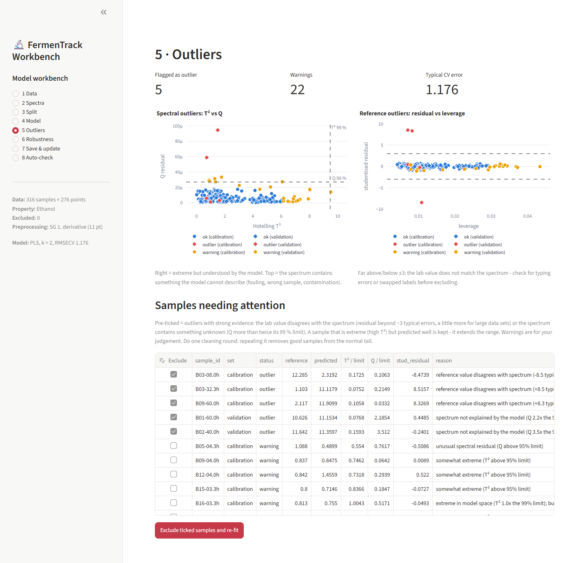
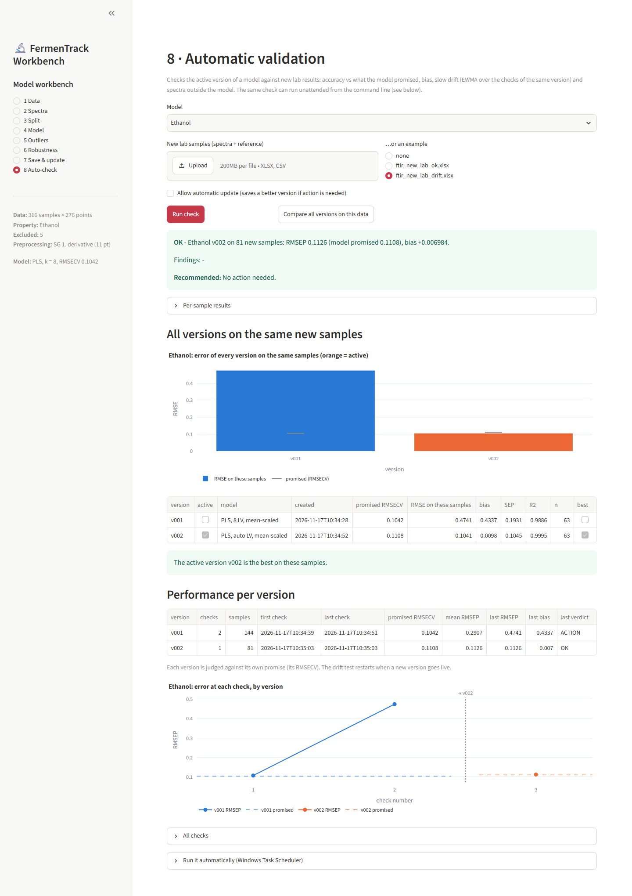
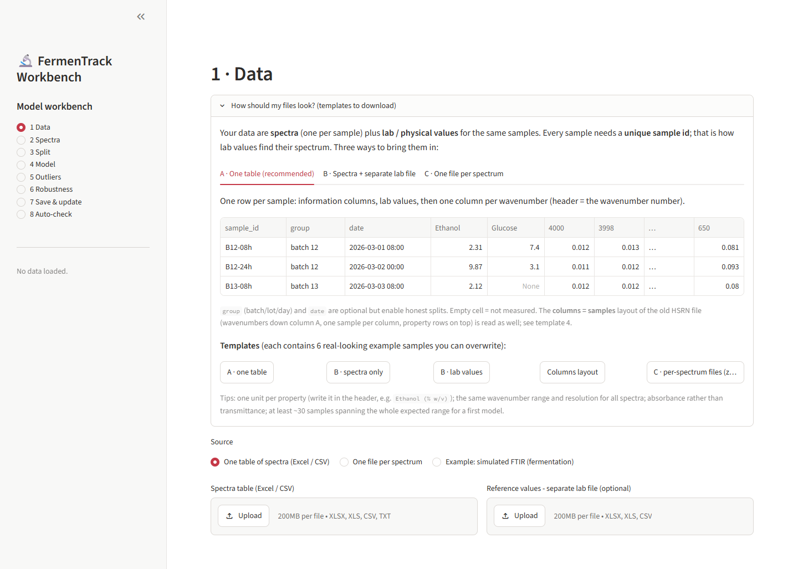

# FermenTrack user guide

A step-by-step guide for using FermenTrack without writing any code.
FermenTrack has two parts, both in the same folder and the same repository:

| Part | What it is for | How to open |
|---|---|---|
| **Dashboard** | Watch simulated fermentation batches "live": concentrations, final-ethanol forecast, alerts, model performance | Double-click **`FermenTrack.bat`** → browser opens at `http://localhost:8501` |
| **Model Workbench** | Build, check, update and auto-validate your **own** PLS / ANN models from FTIR (or NIR) spectra + lab values | Double-click **`Workbench.bat`** → `http://localhost:8502`, **or** choose *Model workbench* in the dashboard's left menu |

Keep the black window that opens with the `.bat` file open while you work; closing it stops the app.

---

## 1. First start

1. Install Python 3.10 or newer (once).
2. Double-click `FermenTrack.bat` or `Workbench.bat`. The first time, missing packages are
   installed automatically, which takes a few minutes.
3. The dashboard simulates its 80 batches the first time it opens (~15 s); later starts are instant.

---

## 2. Dashboard

| Page (left menu) | What to look at |
|---|---|
| **Batch monitor** | Pick a batch, move the *Simulated clock* slider. Lines = in-line predictions, diamonds = lab samples. Alerts appear with a reason and a suggested action. Good examples: **batch 68** (bacterial contamination flagged at 30 h) and **batch 62** (probe fouling; the forecast is frozen because the measurement cannot be trusted). |
| **Plant overview** | All 80 batches: final yield, every alert, ground truth of the simulation. |
| **Model performance** | How good each model is, scored on batches it never saw: PLS calibration, early yield forecast, anomaly detection, calibration-drift chart. |
| **Model workbench** | The workbench (section 3). |
| **About** | Short summary of the methods. |

Shareable links: `?page=monitor&batch=68&t=30`, `?page=performance&section=yield`.

---

## 3. Model Workbench, step by step

### Example files (in the `examples/` folder)

| File | Used in | What it shows |
|---|---|---|
| `ftir_calibration.xlsx` | Step 1 | 316 lab-checked samples to build a model. Contains **3 planted problems** for step 5: a fouled-probe spectrum (`B02-40.0h`), a typing error (`B03-32.3h`), two swapped labels (`B03-08.0h`, `B09-60.0h`). |
| `ftir_new_lab_ok.xlsx` | Step 8 | New lab results, instrument healthy → verdict **OK** |
| `ftir_new_lab_drift.xlsx` | Steps 7 and 8 | New lab results, instrument drifting → verdict **ACTION**, model is updated |

You do not need to browse for these: steps 1, 7 and 8 each have an *example* option.

### Suggested first run (about 5 minutes)

1. **1 Data** → *Source: Example* → **Load example calibration data**. Property: *Ethanol*.
2. **2 Spectra** → look at the overlaid spectra (light → dark blue = low → high ethanol).
   Set *Derivative* to **1st**.
3. **3 Split** → method *By group* → **Apply split**.
4. **4 Model** → *PLS* → **Fit model**. Note RMSECV is about 1.2 and only 2 components are used:
   the planted problems are spoiling the model.
5. **5 Outliers** → the planted samples are pre-ticked with their reasons →
   **Exclude ticked samples and re-fit**. RMSECV drops to about **0.10**.
6. **6 Robustness** → run the three tests and see how the model copes with disturbed spectra.
7. **7 Save & update** → **Save as new version** (saved as `Ethanol v001`).
8. **8 Auto-check** → example `ftir_new_lab_ok.xlsx` → **Run check** → **OK**.
   Then `ftir_new_lab_drift.xlsx` with *Allow automatic update* ticked → **ACTION** →
   a better version `v002` is saved and activated.





### What each step does

| Step | You do | Good to know |
|---|---|---|
| **1 Data** | Upload one table of spectra, or many single-spectrum files, plus an optional lab file (see *Preparing your own data* below); choose the property; tick *Exclude* and type a reason for any sample you want to leave out | Two layouts are recognised: **rows = samples** (wavenumbers as column headers) or **columns = samples** (wavenumbers in column A). For Excel files with several sheets, pick the sheet. A reference file needs a `sample_id` column; optional `group` (batch/lot) and `date` columns enable better splits. *Download cleaned data* saves the edited set. |
| **2 Spectra** | Choose wavenumber regions (e.g. `980-1200, 1250-1480`), baseline, SNV/MSC, smoothing, derivative | Raw and preprocessed spectra are drawn on top of each other. The expander shows the mean spectrum and the correlation of every wavenumber with the property, which helps choose regions. |
| **3 Split** | Choose a split method and validation share → **Apply split** | *By group* is the honest default when samples of one batch are related; *By order/date* tests "train on the past, predict the future". The PCA plot shows whether validation samples sit inside the calibration space. |
| **4 Model** | PLS or ANN, size by cross-validation or fixed → **Fit model** | Judge models by **RMSECV** and validation **RMSEP**, not by RMSEC. RPD > 3 is fine for screening, > 5 for quality control. Each fitted model is added to a comparison table. ANN = small neural network fed with PLS scores; useful when the relationship is curved. |
| **5 Outliers** | Review flagged samples, tick, **Exclude … and re-fit** | **T²** = extreme but understood; **Q** = spectrum contains something unknown (fouling, wrong sample); **studentised residual** = lab value disagrees with the spectrum (typing error, swapped label). Only strong cases are pre-ticked. Every exclusion is logged and can be undone in the *Exclusion log*. |
| **6 Robustness** | Run perturbation, resampling and y-randomisation tests | Lower lines = more robust. "RMSEP doubles at" is a handy single number for comparing preprocessing choices. y-randomisation must fail clearly for shuffled data; otherwise the model is fitting chance. |
| **7 Save & update** | Save a version with notes; later upload new lab-checked samples → **Build update candidates** | Versions `v001`, `v002`… with a *model card* (settings, statistics, data fingerprint, excluded samples). Two update candidates are compared on new samples they never saw: a **bias update** (fixes a constant offset) or a **refit with old + new samples** (fixes new variation). |
| **8 Auto-check** | Pick a model, give new lab results → **Run check**; **Compare all versions on this data** to see old vs new side by side | Verdict **OK / WARNING / ACTION** with findings and the likely fix. The history chart shows every check in the colour of the version it tested, with a line where a new version went live; *Performance per version* summarises each version since it went live. The drift test restarts for each version. Saving an identical model twice is refused. With *Allow automatic update*, a new version is activated only if it is better on held-out new samples and not worse on the original validation. |

### Preparing your own data




Your data = **one spectrum per sample** + **lab / physical values** for the same samples.
Every sample needs a **unique `sample_id`**; this is how a lab value finds its spectrum.
Templates are in `examples/templates/` and can also be downloaded in step 1 under
*How should my files look?*. Each one holds 6 example samples you can overwrite.

**Option A: one table (recommended).** Template `1_spectra_and_lab_values_in_one_file.xlsx`.
One row per sample:

| sample_id | group | date | Ethanol (% w/v) | Glucose (% w/v) | 4000 | 3998 | … | 650 |
|---|---|---|---|---|---|---|---|---|
| B12-08h | batch 12 | 2026-03-01 08:00 | 2.31 | 7.40 | 0.012 | 0.013 | … | 0.081 |
| B12-24h | batch 12 | 2026-03-02 00:00 | 9.87 | 3.10 | 0.011 | 0.012 | … | 0.093 |
| B13-08h | batch 13 | 2026-03-03 08:00 | 2.12 | *(empty)* | 0.012 | 0.012 | … | 0.080 |

* `sample_id`: required, unique.
* `group`: optional; batch, lot or day. Enables the honest *by group* split and cross-validation.
* `date`: optional; enables the *by date* split ("train on the past, test on the future").
* Property columns: one per lab / physical measurement, numbers only, empty if not measured.
  A decimal comma (`12,5`) is fine. Put the unit in the header.
* Wavenumber columns: every header that is a number between 200 and 15000 is read as a
  wavenumber (cm⁻¹); the cells are absorbance values.
* Any other text column (operator, comment…) is kept as sample information.

**Option B: spectra and lab values in separate files.** Templates `2_spectra_only.xlsx` +
`3_lab_values.xlsx`. Useful when the lab results arrive later. In step 1 choose
*One table of spectra*, put the spectra file left and the lab file right; they are matched by
`sample_id`.

**Option C: one file per spectrum (typical FTIR export).** Example files are in
`examples/templates/single_spectra/`. Each file has two columns, wavenumber and absorbance;
header lines, comma / semicolon / tab separators and decimal commas are understood.
**Name each file after its sample** (`B12-08h.csv`), because the file name becomes the
`sample_id`. In step 1 choose *One file per spectrum*, select all files at once (Ctrl+A in the
file window), and add the lab values file (as in B). If files have slightly different
wavenumber points, all spectra are aligned to the first file within the shared range.

**Columns = samples.** Template `4_columns_layout.xlsx`:
wavenumbers down column A, one sample per column, rows such as `No`, `Date` and property names
on top. Workbooks in this layout can be loaded directly; pick the sheet in step 1.

**Good practice for a first model**

* At least ~30 samples (more is better) covering the **whole** range you expect in use, from
  low to high for every property.
* The same instrument settings for all spectra (range, resolution, number of scans).
  Use **absorbance**, not transmittance.
* Measure the lab value on the **same sample** at the **same time** as the spectrum.
* Record the batch / lot in `group`. Without it, samples from one batch can sit in both
  calibration and validation, which makes the model look better than it is.
* After loading, check in step 1 that the number of samples and properties is right, and in
  step 2 that no spectrum looks odd.

Your saved models live in the `model_registry/` folder, which is **not** uploaded to GitHub.

### Your saved models drive the dashboard

When a model is saved in step 7 and its version is **active**, the dashboard uses it instead of
its built-in PLS model for the matching analyte (matched by name, e.g. `Ethanol`,
`Ethanol (% w/v)`, `DP4+`). In-line trajectories, alerts, the yield forecast and calibration
health then all run on your model. The dashboard recalculates automatically (~15 s) whenever an
active version changes. The left menu lists which analytes use a saved model, and
*Model performance → Spectral calibration* shows the model in use and its errors for each
analyte. Models that cannot read the dashboard spectra (e.g. a NIR model, or a name that
matches no analyte) are skipped and the built-in model is kept.

### Running the check automatically every day

```bash
py -3.12 -m fermentrack.workbench.autovalidate --model Ethanol --data "C:\path\to\new_lab.xlsx" --auto-update
```

Windows Task Scheduler → *Create Basic Task* → daily → *Start a program*: program `py`, arguments
as above (without `py`), *Start in* = the FermenTrack folder. Exit code `2` means action is
needed and can trigger an e-mail. Step 8 shows the exact command for the selected model.

---

## 4. Troubleshooting

| Problem | Fix |
|---|---|
| Browser does not open | Go to `http://localhost:8501` (dashboard) or `http://localhost:8502` (workbench). |
| "Could not find wavenumbers" | Wavenumbers must be numbers between 200 and 15000, either as column headers or in the first column. Compare your file with the templates. |
| Lab values do not appear | The `sample_id` in the lab file must be exactly the same as in the spectra (for per-spectrum files: the file name without `.csv`). |
| A property column is missing | It contains text in most rows; keep only numbers there (empty = not measured). |
| "At least 5 calibration samples…" | The chosen property has too few lab values after exclusions. |
| "The data changed since the model was fitted" | You changed exclusions, preprocessing or the split: press **Fit model** again in step 4. |
| A second app does not start | The dashboard uses port 8501 and the workbench 8502; close old black windows first. |
